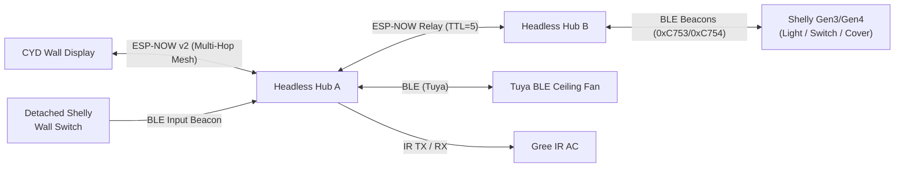

# Headless Hubs & Offline Backup Guide

This guide covers the **Headless BLE/IR Hubs**, **ESP-NOW Multi-Hop Mesh**, **Tuya BLE Ceiling Fans**, **Gree IR Air Conditioners**, **Shelly Gen3/Gen4 Offline BLE Backup**, and **Detached Wall Switch Offline Fallback** features in `cyd-tiled-display`.

---

## 1. Architecture Overview

When Home Assistant and Wi-Fi are online, CYD wall displays control everything normally through Home Assistant's native ESPHome API.

When **Home Assistant is down** or **Wi-Fi is unreachable**, CYD displays automatically fail over to an **ESP-NOW peer-to-peer mesh** backed by one or more inexpensive **Headless Hubs** (e.g., ESP32-C3 / ESP32-S3 / ESP32 boards):

### Why use Headless Hubs?
- **Keeps CYDs fast and stable:** BLE scanning/connections and IR drivers stay off the display ESP32, avoiding flash/RAM pressure and display flicker.
- **Whole-house BLE & IR coverage:** Place cheap ESP32-C3 hubs in rooms near ceiling fans, Shellys, or ACs.
- **Multi-hop ESP-NOW relaying:** Hubs automatically relay ESP-NOW frames (`PROTOCOL_VERSION = 2`, default `TTL = 5`, jittered re-broadcast, and `(origin_id, type, seq)` deduplication) so a CYD or detached wall switch in one room can control a fan or Shelly attached to a hub in another room — even without direct radio line-of-sight.

---

## 2. Headless BLE / IR Hubs

Open **File Management → Headless BLE Hubs** in the Configurator to create, edit, and flash hubs.

### Key Settings
| Setting | Description |
|---|---|
| **Board** | Target ESP32 board (e.g., `seeed_xiao_esp32c3`, `esp32-c3-devkitm-1`, `esp32-s3-devkitc-1`, `esp32dev`). |
| **ESP-NOW Network Key** | Shared key (`espnow_network_key`) stored in the Configurator vault and automatically synced to all CYDs, hubs, and Shelly backup scripts. Authenticates all ESP-NOW and Shelly BLE packets. |
| **Fallback Wi-Fi Channel** | Wi-Fi channel (`1–13`) used by ESP-NOW when the home router is offline. Set all hubs and CYDs to the same channel. |

### Automatic CYD Failover
- When a CYD loses its Home Assistant API connection, tiles linked to a Tuya BLE fan or Shelly entity seamlessly route commands over ESP-NOW.
- If no hub is reachable over ESP-NOW while offline, the CYD displays a compact **No Hub** indicator.
- Headless hubs are included automatically in **Batch OTA Updates** (`File Management → Update All Online CYD Devices (OTA)`), or can be flashed individually via each hub's **Install** button.

---

## 3. Tuya BLE Ceiling Fans

Headless hubs can connect directly to Tuya BLE ceiling fans (fan speed, direction, oscillation, and integrated light) and expose them both to Home Assistant and to CYD displays over ESP-NOW.

### Setup Workflow
1. Open **Find BLE Fans** or **Headless BLE Hubs** in the Configurator to discover/import fan credentials (`device_id`, `local_key`, `mac_address`, `uuid`).
2. Credentials are persisted in the Configurator vault (`/config/esphome/.cyd_ble_fans.json`).
3. Assign each fan to **one** Headless Hub (the hub closest to that fan). If a fan is already hosted on another hub or CYD, the Configurator detects the conflict and offers atomic reassignment.
4. Flash the hub. In Home Assistant, each fan exposes its fan/light controls plus a diagnostic **`BLE Connected`** binary sensor.
5. Any CYD tile referencing that fan's `fan.*` or `light.*` entity is automatically linked for ESP-NOW offline fallback when you save the CYD configuration.

---

## 4. Gree IR Air Conditioners

Any Headless Hub can also act as an IR climate controller for Gree (and compatible) air conditioners.

### Configuration
In **Headless BLE Hubs → Edit Hub → Gree IR AC**:
- **Name & Model:** Friendly name (e.g., `Office AC`) and Gree protocol variant (`generic`, `yaa`, etc.). The AC is registered in Home Assistant as a separate sub-device (`relation: via` the hub).
- **TX Pin (required):** GPIO connected to your IR LED / emitter transistor.
- **RX Pin (optional):** GPIO connected to a 38 kHz IR receiver module. Leave blank for **TX-only** mode (omits `remote_receiver`).
- **Debug IR Protocol (optional, requires RX Pin):** Exposes an **`IR Debug Protocol`** text sensor in Home Assistant that logs decoded IR frames when you press buttons on the physical AC remote — useful for identifying the exact protocol/model.

---

## 5. Shelly Gen3 / Gen4 Offline BLE Backup

Open **File Management → Shelly Offline Backup (BLE)** in the Configurator.

### How It Works
- A lightweight JavaScript script (`shelly/cyd_ble_backup.js`) runs on each Shelly Gen3/Gen4 device.
- The Shelly periodically broadcasts its current relay/light/cover state (and immediately broadcasts when toggled or when a detached wall switch is pressed) using authenticated 14-byte BLE Service Data beacons (`UUID 0xC754`), and listens for authenticated command beacons (`UUID 0xC753`) from headless hubs.
- **Zero-config hub discovery:** Every headless hub automatically discovers every Shelly in BLE range — you do **not** need to assign Shellys to specific hubs.
- **Automatic CYD tile linking:** When saving a CYD configuration, any Shelly `light.*`, `switch.*`, or `cover.*` entity used on a tile is automatically linked to its Shelly MAC and channel for ESP-NOW offline fallback.
- **Multi-channel & `switch_as_x` handling:** Multi-channel Shelly Gen3/Gen4 devices (such as Shelly 2PM Gen4, which Home Assistant splits into a parent device + channel sub-devices) are automatically merged by MAC, HA `switch_as_x` ("Show as Light") duplicates are collapsed to a single channel preferring `light.*`, and `cyd_ble_backup` script switches are filtered out.

### Deploying the Script to Shellys
1. Open **File Management → Shelly Offline Backup (BLE)**.
2. Shellys referenced by any of your CYDs are sorted to the top (with per-CYD badges) and pre-selected. Use **Select Used | All | None** to adjust selection.
3. If your Shellys have RPC authentication enabled, enter the **Shelly RPC password** (optional).
4. Click **Deploy Script to N Selected**. The script is chunk-uploaded with your shared `espnow_network_key`, enabled on boot, and started immediately, with a live progress bar, `ok / failed` counters, and a **Cancel** button.

### `Visible Shellys` Diagnostic Sensor
Each headless hub exposes a **`Visible Shellys`** text sensor in Home Assistant:
- Updates every **30 seconds** (or immediately when a new Shelly is first heard).
- Shows human-readable Shelly names (from Home Assistant) with RSSI, sorted strongest-first, e.g.:
  `26: L-Office (-54dBm), Office Blind (-61dBm), ... (+18 more)`
- Automatically stays under Home Assistant's 255-character state limit.

> [!NOTE]
> **Shelly Zigbee (`*ZB`) Firmware Limitation:**
> Devices running Shelly's Zigbee (`*ZB`) firmware can transmit outbound BLE beacons (state updates and detached wall switch presses work), but their BLE radio does not support continuous BLE RX scanning for incoming hub commands. The deployer flags `*ZB` devices with a warning.

---

## 6. Detached Wall Switches (Offline Fallback)

If you have Shelly wall switches configured in **Detached** mode (for example, wired to a wall switch whose HA automation toggles a Tuya BLE ceiling fan light or another Shelly light), they normally stop working if Home Assistant or Wi-Fi goes down.

With **Detached Wall Switches → Light / Shelly Output (Offline Fallback)** (Section 2 of the Shelly Offline Backup dialog):

### How Offline Fallback Works
1. When you flip a detached wall switch, `cyd_ble_backup.js` broadcasts a BLE `INPUT_TOGGLE` beacon containing its `source_id`, input channel (`0–3`), sequence number, and whether the Shelly's Wi-Fi is down.
2. Any headless hub hearing the beacon checks if **Home Assistant API is disconnected** OR **the Shelly's Wi-Fi is down**:
   - If both HA and Wi-Fi are up, hubs stay silent so your normal HA automation handles it (no double toggle).
   - If either HA or Shelly Wi-Fi is down, the hub immediately toggles the linked target:
     - **Tuya BLE Ceiling Fan Light:** toggled locally over BLE if hosted on that hub, or forwarded over ESP-NOW (`CmdOpcode::LIGHT_TOGGLE`) to the hub hosting that fan.
     - **Shelly Output (Light / Switch):** toggled locally over BLE (`SW_TOGGLE`) if in BLE range, or forwarded over ESP-NOW (`MsgType::SHELLY_CMD`) to a hub in range of the target Shelly.
3. All hubs use the wall switch's `(source_id, seq)` for deduplication, so even if 3 hubs hear the same switch press, the target light toggles **once**.

### Smart Auto-Detected Suggestions
When you open the Shelly dialog, the Configurator probes non-cover Shellys via `Shelly.GetConfig` in parallel and suggests rules from two tiers:
- **Tier 1 (HA Automations):** Parses `/config/automations.yaml` for automations triggered by a Shelly input that toggle a Tuya BLE ceiling fan light.
- **Tier 2 (Same HA Area):** Suggests Shellys in the same HA area as a ceiling fan light **only** if `Shelly.GetConfig` verifies `in_mode == "detached"` (or standalone `input:N` without a relay) in **switch** mode. Covers, attached light switches, and **button-mode** inputs (`input:N.type == "button"`) are excluded.

### Live Over-the-Air Sync (No Re-Flashing)
When you click **Save & Sync to All Hubs**:
1. The Configurator updates the `detached_switches:` block in every headless hub's YAML file.
2. It immediately calls Home Assistant's `esphome.<hub>_sync_shelly_detached_switches` service on every online hub.
3. Each hub applies the new rules in RAM **and** persists them to ESP32 NVS, restoring them automatically on reboot even if Home Assistant is offline.

> [!TIP]
> Hubs only need to be flashed **once** with the firmware supporting `sync_shelly_detached_switches`. After that, adding, editing, or removing detached-switch rules applies live across all online hubs with zero re-flashing.

---

## 7. Quick Troubleshooting

| Symptom | What to Check |
|---|---|
| Shelly not listed in `Visible Shellys` | Verify `cyd_ble_backup.js` is running on the Shelly, both use the same `espnow_network_key`, and the Shelly is within BLE range of a headless hub. |
| Detached wall switch doesn't toggle offline | Verify the switch is in `detached` mode, `cyd_ble_backup.js` is deployed, and **Save & Sync to All Hubs** confirmed live sync (or hubs were re-flashed). |
| Detached switch toggles twice when HA is online | Check that the hub is connected to HA and the Shelly has Wi-Fi (`wifi_down=0`). Offline fallback only fires when HA is disconnected or the Shelly's Wi-Fi is down. |
| CYD shows `No Hub` while offline | Confirm at least one headless hub is powered on, shares the same `espnow_network_key`, and uses the same `fallback_channel`. |
| `*ZB` warning during Shelly script deploy | That Shelly is running Zigbee firmware — outbound detached-switch beacons work, but BLE RX control requires standard Wi-Fi/BLE firmware. |
